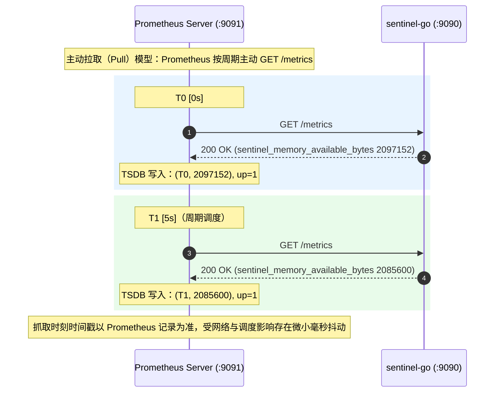

[prometheus](https://github.com/prometheus/prometheus)(普罗米修斯)是一个系统和服务监控系统，普罗米修斯可以按给定间隔从配置的目标收集指标，评估规则表达式，显示结果，并可在观察到指定条件时触发告警

## Prometheus抓取什么

在生产环境中，Prometheus一般运行在云端中，通过HTTP协议抓取集群中各个节点暴露的端口，而不是自己作为一个Agent去收集集群节点的环境

这就涉及到一个约定问题，普罗米修斯如何正确的读取到节点返回的响应?


### metrics定义与Gauge文本格式

我们先明确三个定义:
- **指标（Metric）**：一个带有明确名称和单位的测量值，HTTP 接口只是把这次测量值交给外部读取的传输载体
- **仪表盘指标（Gauge）**：表示当前状态的瞬时测量值，数值可以上升也可以下降。可用内存随进程分配与释放而波动，符合 `Gauge` 的特征
-  **单调递增计数器（Counter）** 仅适合累计事件次数（通常只增不减，仅在进程重启时重置），比如累计CPU时间
- **Exposition Format（指标暴露格式）**：提供一个能被监控程序读取的接口规范

我们这节用 go 语言抓取 `/proc/meminfo` 中的 `MemAvailable` 来展示，所以 `MemAvailable` 的值(乘1024) 便是我们这次的指标

对于 *Exposition Format* ，我们自然的采用 *Prometheus 传统 HTTP 文本暴露格式* 这个格式将在下面介绍

---

一次成功的 `/metrics` 响应由响应头和三行响应体组成。

其中响应头指定协议版本与编码：

```http
Content-Type: text/plain; version=0.0.4; charset=utf-8
```

响应体我们约定为三行文本:

```http
# HELP sentinel_memory_available_bytes Estimated available memory in bytes.
# TYPE sentinel_memory_available_bytes gauge
sentinel_memory_available_bytes 2097152

```

其基本构造:
```http
# HELP [] {Explanation}
# TYPE [] {type}
[] {numerical value}
```

这三行的含义定义可以这样解释:
- \# HELP 行说明指标含义
- \# TYPE 行声明类型(如 gauge,counter)
- 最后一行表示样本行，是这次暴露的数据

其中三行中的指标名称必须一致，同时每行的末尾都必须带换行符 `\n` 

---

## Prometheus如何抓取


当我们实现了接口之后，我们就需要自己配置一下普罗米修斯来实现对节点内容的定期抓取了

首先我们先了解分工和整体流程:



>[!note]
>- **谁发请求**：Prometheus 是主动拉取（Pull）模型。Prometheus 作为客户端，按照配置的时间周期（如每 5 秒一次）主动向被监控服务发送 HTTP `GET /metrics` 请求。go 服务只需要被动监听端口并响应，不在代码内部维持抓取定时器
>- **谁保存历史**：Go 服务是无状态的采集端，处理完一次请求后数据即在内存中丢弃；Prometheus Server 内部集成时序数据库（TSDB）,每次拉取成功后会把当前样本值与抓取时刻的时间戳（精确到毫秒）持久化写入磁盘
>- **数据库有什么好处**：写入 Prometheus TSDB 之后的数据成为**时间序列（Time Series）**，可以通过 PromQL 跨越时间轴计算波动、对齐不同实例、进行单位换算与阈值比对。


---

## Prometheus中的逻辑

在Prometheus中，获取到的

- **Target（目标）**：具体被抓取的网络端点，形式严格约定为 `host:port`（例如 `127.0.0.1:9090`）。一个 Target 对应一个暴露指标的 HTTP 进程实例
- **Job（作业）**：一组执行相同业务逻辑或具有相同监控目的的 Target 集合；可以理解为一组意图相同的Target集合
- **Instance（实例）**：当 Prometheus 完成抓取时，会自动在时序数据上打上 `instance="<host:port>"` 标签。`job` 与 `instance` 共同标识了抓取来源目标，也就是Instance是Job下的一个具体角色

存放在Prometheus中的时间序列中单个样本的**逻辑表示**可抽象为：

```txt
指标名{标签名="标签值", ...} 浮点数值 毫秒时间戳
```

比如

```txt
sentinel_memory_available_bytes{job="sentinel", instance="127.0.0.1:9090"} 2097152000 1760000000000
```

解读下来就是我们的指标，然后是这个指标属于哪个job，来自哪个Target，具体的数值是什么，最后是时间戳


---

## 抓取配置与地址格式


Prometheus 通过根配置文件（通常为 `prometheus.yml`）声明抓取行为

下面我们给出一个最小配置实例：

```yml
global:
  scrape_interval: 5s     # 抓取周期：每隔 5 秒发一次 GET 请求
  scrape_timeout: 4s      # 抓取超时：单次请求超过 4 秒未完成则判定为失败

scrape_configs:
  - job_name: 'sentinel'
    metrics_path: '/metrics'    # 抓取路径（默认即为 /metrics，显式声明）
    static_configs:
      - targets: ['127.0.0.1:9090']  # 必须写 host:port，不能带 http://
```

其中有几个要点需要我们知道：
- Target 格式严禁包含协议与路径
	- 即targets: ['127.0.0.1:9090']不能写成 ['http://127.0.0.1:9090'] 或者 ['127.0.0.1:9090/metrics']
- 超时时间不得超过抓取周期
	- 如果超时时间大于抓取周期，当前周期的抓取还未结束就会与下一周期的抓取重叠堆积

可以参考 [Prometheus 配置官方规范](https://prometheus.io/docs/prometheus/latest/configuration/configuration/) 来编写扩展 `prometheus.yml`文件，在编写完成后，需要进行一次 `promtool check config <文件名>` 进行静态检查


---