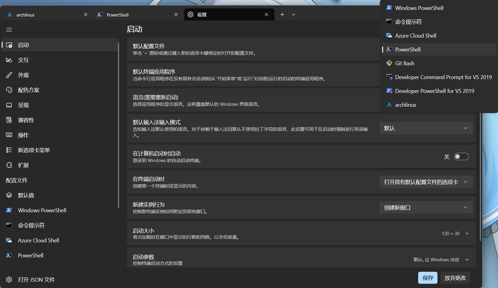
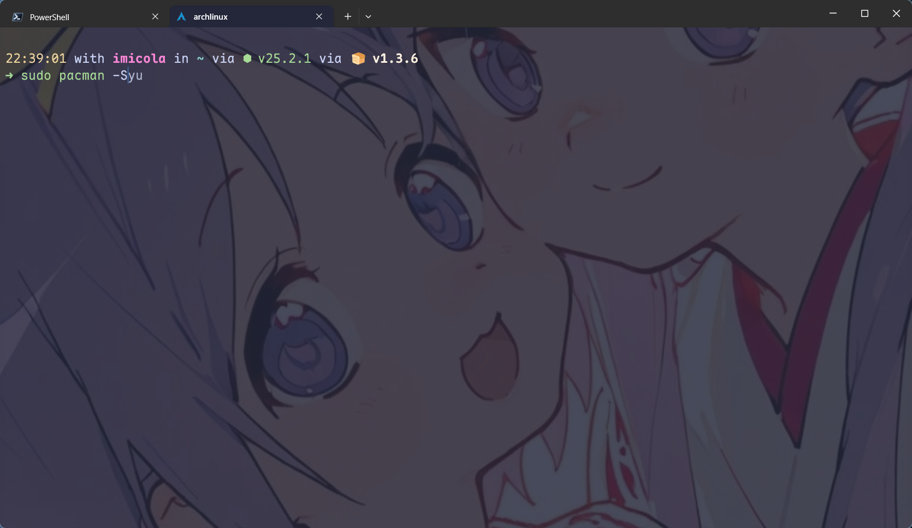
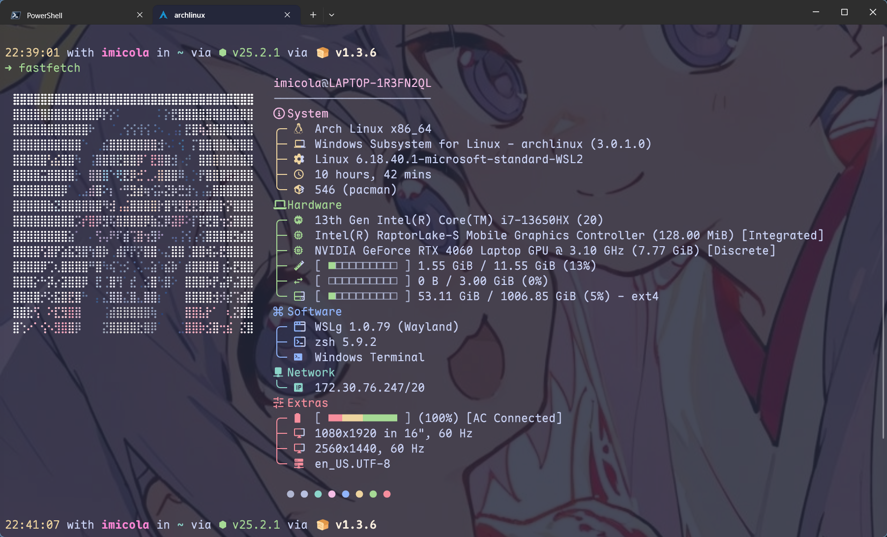
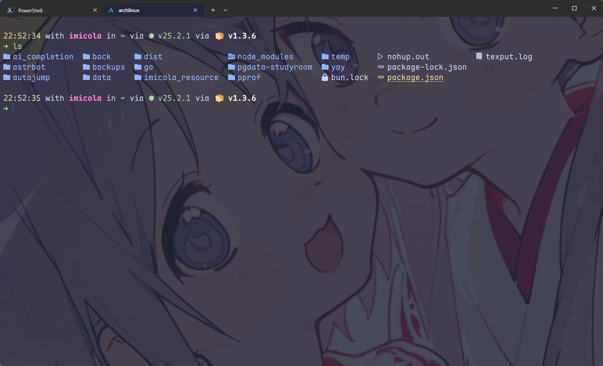
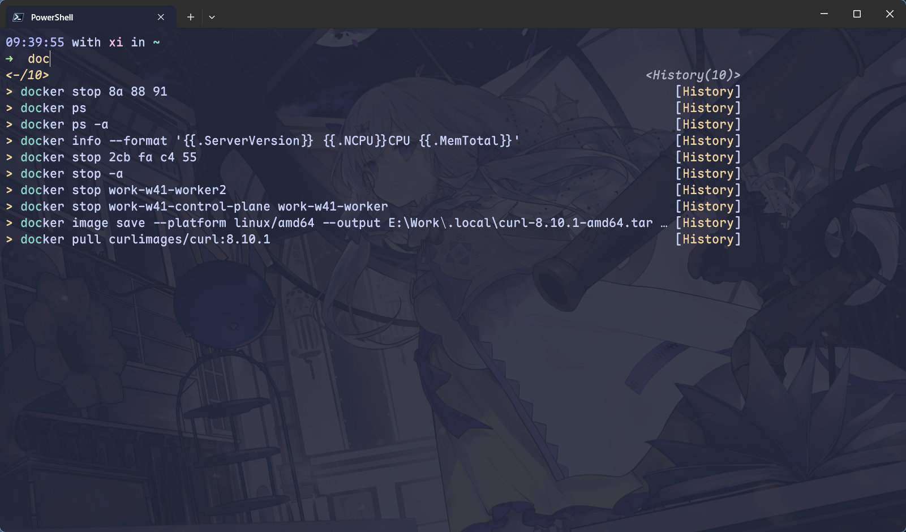

本文是来自对 [命令行的艺术](https://github.com/jlevy/the-art-of-command-line/blob/master/README-zh.md) 的拙劣模仿，结合了一些笔者的实际使用经验，得到的一个，"如何配置好看且顺手的命令行" 的小教程吧

## 终端环境

一个好的终端环境对命令行的配置至关重要，如果你的终端不能配置字体，不支持流输出，不支持背景图片配置，那我只能说你不是一个合格的 "技术宅"(

笔者没怎么用过真机Linux，在此不做推荐。

而 Windows 上，首推 Window Terminal (wt) ,作为微软良心且 [开源](https://github.com/microsoft/terminal) 的产品，wt 预安装在每个 Windows 用户的设备上, 拥有丰富的配置选项, 只不过大部分人都不知道怎么将一个黑色的,使用微软雅黑中文字体显示英文符号的超级无敌对比度的初始终端(或许是蓝色?)配置成好看的窗口

### 选择一个shell

在配置终端前，先选择一个适合自己的 shell 环境, 如果你是一个小白，那么你的默认 shell 环境大概率是 powershell 5 ,它已经过时了,现在建议你升级到[powershell 7](https://github.com/PowerShell/PowerShell) ，如果你有Agent或者Harness,告诉它需求，它会帮你的;如果没有，你可以尝试去 github 下载安装包，或者使用 `winget install pwsh` 命令，使用 winget 包管理器完成安装

下载安装完成后，你可能需要重启一次你的 wt 来导入 pwsh7 的配置文件，然后使用快捷键 `ctrl + ，` 进入 wt 的配置界面，在 "启动" 选项卡中选择 `powershell` 作为你的默认配置文件，如果这里有两个 `powershell` ,选择黑色的那个



当然，如果你更加熟悉bash语法环境,你也可以试试用 *git bash* 作为主力终端，使用 *git bash* 的另外一个好处就是: **在你跑一些 Agent 的时候, LLM不会和 pwsh 语法斗殴**
(笔者现在主力用6.1sol也会经常出现和pwsh语法打架的环节)

### 配置这个 shell 窗口

在 wt 的设计界面，左侧的选项卡向下滑，应该能看见你 wt 上 shell 的配置文件，请直接修改 *其他设置-外观* ,除此以外的配置尽量保持默认选项，除非你真的知道你自己在干什么

进入外观后，可以看到第一个 配色方案 文本，可以挑选自己喜爱的配色方案设置，但是说实话，wt 自带的配色方案不敢说好看喵，这里推荐一个 配色方案合集 [catppuccin](https://catppuccin.com/) ,这个提供了一整套好看的配色，而且覆盖了很多常见，对于我们需要的 wt 配色，[这个项目](https://github.com/catppuccin/windows-terminal) 就提供了解决方案，当然你现在直接看我下面的设置就行了，或者你直接让你的大模型帮你设置(~~实际上这个文章中的所有内容大模型都可以帮你做好，你只需要知道改了什么就行~~)

- 在当前页面，你应该能看见一个 「打开JSON文件」 的按钮
- 使用任意能编辑文件的编辑器打开,vscode,zed,甚至是记事本
- 在 [这里](https://github.com/catppuccin/windows-terminal) 选择一个你喜欢的配色方案 (frappe, latte, macchiato, mocha).json 和 与其对应的 XXXTheme.json
- 将 **不带Theme** 的文件内容(如`macchiato.json`)复制，并且如下面的格式粘贴到 wt 的配置文件中

```json
{
	// 你的其他配置 (注意wt json不允许注释,这一行要删)
	"schemes":
	[
		{
			"background": "#24273A",
			"black": "#494D64",
			"blue": "#8AADF4",
			"brightBlack": "#5B6078",
			"brightBlue": "#8AADF4",
			"brightCyan": "#8BD5CA",
			"brightGreen": "#A6DA95",
			"brightPurple": "#F5BDE6",
			"brightRed": "#ED8796",
			"brightWhite": "#A5ADCB",
			"brightYellow": "#EED49F",
			"cursorColor": "#F4DBD6",
			"cyan": "#8BD5CA",
			"foreground": "#CAD3F5",
			"green": "#A6DA95",
			"name": "Catppuccin Macchiato",
			"purple": "#F5BDE6",
			"red": "#ED8796",
			"selectionBackground": "#5B6078",
			"white": "#B8C0E0",
			"yellow": "#EED49F"
		}
	],
}
```

- 将 **带Theme** 的文件内容(如`macchiatoTheme.json`)复制，并且如下面的格式粘贴到 wt 的配置文件中

```json
{
	"themes":
	[
		{
			"name": "Catppuccin Macchiato",
			"tab":
			{
				"background": "#24273AFF",
				"iconStyle": "default",
				"showCloseButton": "always",
				"unfocusedBackground": null
			},
			"tabRow":
			{
				"background": "#1E2030FF",
				"unfocusedBackground": "#181926FF"
			},
			"window":
			{
				"applicationTheme": "dark",
				"experimental.rainbowFrame": false,
				"frame": null,
				"unfocusedFrame": null,
				"useMica": false
			}
		}
	],
}
```

注意这里的两个 json 键都是一级,不要放到其他的键下了

- 保存，然后退出这个 json 文件的编辑
- 回到你的 shell 的配置界面，选择 配色方案 选项，现在你加入的主题应该会在选择框中
- 选择它即可

---

然后是 「字体」 选项，你应该选择一个 "好看且多功能" 的字体集，好看是指字体在代码阅读层面是清晰且分明的，多功能指字体可以承担部分"字符集"的作用，这里特指带 *Nerd* 或者 *NF* 表示的字体，例如 `JetBrainsMono Nerd Font`，但是我这里更加推荐 `Maple Mono NF CN`

你可以在 [字体下载 | Maple Mono](https://font.subf.dev/zh-cn/download/) 这里下载，也可以直接点击 [这里](https://github.com/subframe7536/maple-font/releases/download/v7.9/MapleMono-NF-CN-unhinted.zip) 下载

下载完成后你会得到一个压缩包,解压后在解压出来的文件夹中按下 `ctrl + a`全选文件，右键后找到 "安装" 选项，如果没有，请在 "显示更多选项" 中查找

安装完成后就可以回到 shell 的字体配置，选择刚刚安装好的 `Maple Mono NF CN` 使用即可

接下来的一些配置，基本都是字面意思, 「字号」「行高」「单元格宽度」保持默认即可

往下滑可以看到 「背景图像路径」,优秀 技术宅 都会选择一张适合自己的图片作为终端背景喵(

「拉伸模式」 选择 「均匀填充」,对齐选择 "居中"，不透明度选择 10% 最好(太高了容易看不清字)

下面的有个 「透明度」设置，可以选择 75% 左右，然后根据个人喜好配置 「是否启用亚克力效果」，反正 *imicola* 是挺喜欢的

---

### 配置 Shell

要想 shell 好用，不光是 shell 的窗口，shell 本身也值得精细配置，下面我会讲述linux 的 Zsh 和 pwsh 的关于我自己是如何配置的，当然你也可以自己选择你喜欢的方式，去折腾这一圈东西

#### Zsh配置

先看效果:





要实现这样的效果，我们首先需要安装系统包，使用你对应的发行版(*imicola*这里是Arch)安装

```sh
sudo pacman -S zsh eza fzf fastfetch
```

然后我们这个是以 `oh-my-zsh` 为框架的命令行系统,安装 `oh-my-zsh` 并且将 `zsh` 设定为 **默认shell**

```sh
sh -c "$(curl -fsSL https://raw.githubusercontent.com/ohmyzsh/ohmyzsh/master/tools/install.sh)" "" --unattended
chsh -s /usr/bin/zsh
```

接着我们装 *spaceship* 主题，当然你也可以选择你喜欢的主题

```sh
ZSH_CUSTOM="${ZSH_CUSTOM:-$HOME/.oh-my-zsh/custom}"
git clone https://github.com/spaceship-prompt/spaceship-prompt.git "$ZSH_CUSTOM/themes/spaceship-prompt" --depth=1
ln -s "$ZSH_CUSTOM/themes/spaceship-prompt/spaceship.zsh-theme" "$ZSH_CUSTOM/themes/spaceship.zsh-theme"
```

随后是 `oh-my-zsh` 的两个第三方插件，分别用来显示补全和命令高亮

```sh
git clone https://github.com/zsh-users/zsh-autosuggestions ${ZSH_CUSTOM:-~/.oh-my-zsh/custom}/plugins/zsh-autosuggestions
git clone https://github.com/zsh-users/zsh-syntax-highlighting.git ${ZSH_CUSTOM:-~/.oh-my-zsh/custom}/plugins/zsh-syntax-highlighting
```

随后可以装 *autojump* ,这个命令会解析你经常去的目录，随后使用 `j` 命令 *jump* 到这个目录里，相当好用

```sh
git clone https://gitee.com/lxgyChen/autojump
cd autojump && ./install.py
```

比如我经常访问`/home/imicola/imicola_resource/SRE_Devops/Go` 这个目录，我们就可以用 `j go` 达到这个直接跳转到这个目录的效果

```sh
22:47:57 with imicola in ~ via ⬢ v25.2.1 via 🍞 v1.3.6
➜ j go
/home/imicola/imicola_resource/SRE_Devops/Go
```

随后是对 `.zshrc` 的配置，将这个配置加入你的 `.zshrc` 并且解决冲突后就可以使用

```sh
export ZSH="$HOME/.oh-my-zsh"
ZSH_THEME="spaceship"

plugins=(
	git
	sudo
	copypath
	copyfile
	autojump
	zsh-syntax-highlighting   # 官方要求：必须放最后
	zsh-autosuggestions
)

source $ZSH/oh-my-zsh.sh

# autojump 源码版补加载（omz 的 autojump 插件只负责初始化）
[[ -s $HOME/.autojump/etc/profile.d/autojump.sh ]] && source $HOME/.autojump/etc/profile.d/autojump.sh

# spaceship 微调：常显时间戳、常显粉色用户名
SPACESHIP_TIME_SHOW="true"
SPACESHIP_USER_SHOW="always"
SPACESHIP_USER_COLOR="212"

# alias
alias cls="clear"
alias vi="nvim"
alias vim="nvim"
alias ls="eza --icons --group-directories-first"

# fzf 键绑定（Ctrl+R 模糊历史、Ctrl+T 模糊文件，ALT+C 模糊目录）
source <(fzf --zsh)
```

有两个包没说，一个是 `eza` ,相当与增强版的 `ls`，使用 `alias ls="eza --icons --group-directories-first"` 则可以达到下图样式



还有一个是 `fzf` ,作用是 Ctrl+R 模糊历史、Ctrl+T 模糊文件，ALT+C 模糊目录

---

随后是 *二次元男娘* 时尚单品 `fastfetch` 的配置

在 `~/.config/fastfetch` 中找到 `config.jsonc` 然后配置它

如果你想要 *imicola* 的配置，直接抄下面这份 `config.jsonc` 就行，其中，logo 的配置使用的是 [MurthiNext/img2text: 将图片转换为带有 ANSI 颜色代码的字符画。](https://github.com/MurthiNext/img2text) 这个开源项目喵

<details>
<summary>点开查看完整 config.jsonc</summary>

```jsonc
{
  "$schema": "https://github.com/fastfetch-cli/fastfetch/raw/master/doc/json_schema.json",

  // ═══════════════════════════════════════════════════════════════
  //  Fastfetch Config — Tree-style with color-coded sections
  // ═══════════════════════════════════════════════════════════════
  //
  //  Color scheme:
  //    {#35} magenta  — Section headers
  //    {#33} yellow   — System section
  //    {#32} green    — Hardware section
  //    {#34} blue     — Software section
  //    {#36} cyan     — Network section
  //    {#31} red      — Extras section
  //
  //  To switch logos, change the "type" field:
  //    "small"  → Small Arch ASCII logo (current, works everywhere)
  //    "chafa"  → Custom image as colored ASCII art (needs source/width/height)
  //    "kitty"  → Kitty image protocol (Kitty terminal only)
  //    "sixel"  → Sixel graphics (WezTerm, etc.)
  //    "arch"   → Full-size Arch ASCII logo
  //
  //  To add more modules, follow the tree pattern:
  //    First item:  "key": "╭─ icon"
  //    Middle item: "key": "├─ icon"
  //    Last item:   "key": "╰─ icon"
  //
  //  Available modules: fastfetch --list-modules
  // ═══════════════════════════════════════════════════════════════

  // ── Logo ───────────────────────────────────────────────
  // Option A: Small Arch ASCII logo (default, universal)
  "logo": {
    "type": "auto",
    "source": "~/.config/fastfetch/b.txt",
    "padding": {
      "top": 1,
      "left": 1,
      "right": 3
    }
  },

  // Option B: Custom image via chafa (uncomment to use, comment Option A)
  // "logo": {
  //   "type": "auto",
  //   "source": "~/.config/fastfetch/b.txt",
  //   "width": 28,
  //   "height": 18,
  //   "padding": { "top": 1, "left": 1, "right": 2 }
  // },

  // ── Display ────────────────────────────────────────────
  "display": {
    "separator": "  ",
    "constants": [
      "──────────────────────────────"  // {$1} horizontal rule
    ],
    "percent": {
      "type": 3,         // 1=number, 2=bar, 3=both, 9=colored number
      "width": 0         // 0 disables fixed-width padding (no leading spaces)
    },
    "bar": {
      "char": {
        "elapsed": "■",
        "total": "□"
      }
    }
  },

  // ── Modules ────────────────────────────────────────────
  "modules": [
    // ── Title ──────────────────────────────────────────
    {
      "type": "title",
      "color": {
        "user": "35",
        "at": "90",
        "host": "35"
      }
    },
    {
      "type": "separator",
      "outputColor": "90"
    },

    // ── System ─────────────────────────────────────────
    {
      "type": "custom",
      "format": "{#35} {#1}System{#}"
    },
    {
      "type": "os",
      "key": "╭─ {icon}",
      "keyColor": "33"
    },
    {
      "type": "host",
      "key": "├─ 󰌢",
      "keyColor": "33"
    },
    {
      "type": "kernel",
      "key": "├─ ",
      "keyColor": "33"
    },
    {
      "type": "uptime",
      "key": "├─ 󰅐",
      "keyColor": "33"
    },
    {
      "type": "packages",
      "key": "╰─ 󰏖",
      "keyColor": "33"
    },

    // ── Hardware ───────────────────────────────────────
    {
      "type": "custom",
      "format": "{#32} {#1}Hardware{#}"
    },
    {
      "type": "cpu",
      "key": "╭─ 󰻠",
      "keyColor": "32",
      "format": "{name} ({cores-logical})"
    },
    {
      "type": "gpu",
      "key": "├─ 󰍛",
      "keyColor": "32"
    },
    {
      "type": "memory",
      "key": "├─ 󰑭",
      "keyColor": "32"
    },
    {
      "type": "swap",
      "key": "├─ 󰓡",
      "keyColor": "32"
    },
    {
      "type": "disk",
      "key": "╰─ ",
      "keyColor": "32",
      "folders": "/"
    },

    // ── Software ───────────────────────────────────────
    {
      "type": "custom",
      "format": "{#34}󰘳 {#1}Software{#}"
    },
    {
      "type": "wm",
      "key": "╭─ ",
      "keyColor": "34"
    },
    {
      "type": "shell",
      "key": "├─ ",
      "keyColor": "34"
    },
    {
      "type": "terminal",
      "key": "╰─ ",
      "keyColor": "34"
    },

    // ── Network ────────────────────────────────────────
    {
      "type": "custom",
      "format": "{#36}󰛳 {#1}Network{#}"
    },
    {
      "type": "localip",
      "key": "╰─ 󰩟",
      "keyColor": "36",
      "compact": true,
      "format": "{ipv4} ({ifname})"
    },

    // ── Extras ─────────────────────────────────────────
    {
      "type": "custom",
      "format": "{#31} {#1}Extras{#}"
    },
    {
      "type": "battery",
      "key": "╭─ 󰁹",
      "keyColor": "31"
    },
    {
      "type": "display",
      "key": "├─ 󰍹",
      "keyColor": "31"
    },
    {
      "type": "locale",
      "key": "╰─ 󰒍",
      "keyColor": "31"
    },

    // ── Bottom ─────────────────────────────────────────
    "break",
    {
      "type": "colors",
      "paddingLeft": 2,
      "symbol": "circle"
    }
  ]
}
```

</details>

#### pwsh配置

Linux 这边讲完了，回到 Windows 这边，pwsh 的配置思路和 zsh 不太一样: zsh 那边是 *oh-my-zsh* 框架 + 主题 + 一堆插件，而 pwsh 没有这样统一的框架，我们直接用 *starship* 这个跨 shell 的提示符工具接管外观，再补两个官方模块，最终效果和 zsh 那边几乎一个样——毕竟 *imicola* 的 starship 配置就是照着 *spaceship* 主题的样子调的



需要装的东西一共四个，两个走 `winget`，两个走 pwsh 自己的模块仓库 PSGallery:

```powershell
winget install --id Starship.Starship
winget install --id junegunn.fzf

Install-Module PSFzf -Scope CurrentUser
Install-Module CompletionPredictor -Scope CurrentUser
```

(第一次用 PSGallery 会问你要不要信任这个仓库，回答 `A` 就行)

各自的分工:

- *starship*: 跨 shell 的提示符工具，负责外观，对应 zsh 那边的 *spaceship*
- *PSFzf*: fzf 的 pwsh 集成版，对应 zsh 那边的 `source <(fzf --zsh)`，管 Ctrl+R 模糊历史 / Ctrl+T 模糊文件 / Alt+C 模糊目录，真正干活的还是 winget 装的那个 fzf.exe，模块只是壳
- *CompletionPredictor*: 微软官方的历史预测模块，Tab 补全列表里那条灰色的"你想输入的其实是这个"就是它
- PSReadLine: pwsh 自带，连装都不用装，负责基础的行编辑和灰色历史预测

然后是配置文件。直接 `notepad $PROFILE` 打开编辑
核心配置就这几行:

```powershell
Invoke-Expression (&starship init powershell)
Import-Module PSFzf
Import-Module CompletionPredictor

# PSReadLine: 从历史生成预测，列表视图展示
Set-PSReadLineOption -PredictionSource History
Set-PSReadLineOption -PredictionViewStyle ListView

# Ctrl+R 先绑成清屏，给 PSFzf 挂掉时留个保底
Set-PSReadLineKeyHandler -Key Ctrl+r -Function ClearScreen

# PSFzf 键位: 后面的绑定会覆盖上面的 Ctrl+R，最终生效的是这里
Set-PsFzfOption -PSReadlineChordProvider 'Ctrl+t'
Set-PsFzfOption -PSReadlineChordReverseHistory 'Ctrl+r'
Set-PsFzfOption -PSReadlineChordSetLocation 'Alt+c'
```

starship 的配置在 `~\.config\starship.toml`，想让提示符和 *imicola* 长一个样的话，直接抄下面这份 `starship.toml`，核心思路如下:

- `palette = 'catppuccin_mocha'`，直接用 Catppuccin Mocha 调色板(文件尾部自带整套色值)，和 wt 端的 Catppuccin 配色无缝衔接
- `format` 显式排布一行信息: 时间 → 用户名 → 目录 → git 分支 → 语言版本 → 上条命令耗时，然后换行，第二行只剩一个箭头
- `character` 里成功绿箭头、报错红箭头——对，就是 zsh 那个 `➜`，两套 shell 刻意统一了视觉，切来切去没有陌生感

<details>
<summary>点开查看完整 starship.toml</summary>

```toml
"$schema" = 'https://starship.rs/config-schema.json'

add_newline = false
palette = 'catppuccin_mocha'

# Keep a clean, zsh-like one-line info prompt and a second-line character.
format = """
$time\
$username\
$directory\
$git_branch\
$git_status\
$package\
$c\
$cpp\
$cmake\
$rust\
$golang\
$nodejs\
$php\
$java\
$kotlin\
$haskell\
$python\
$conda\
$cmd_duration\
$line_break\
$character"""

[time]
disabled = false
time_format = "%T"
style = "fg:lavender"
format = '[$time]($style) '

[username]
show_always = true
style_user = "fg:pink"
style_root = "bold fg:red"
format = 'with [$user]($style) '

[directory]
style = "fg:teal"
format = 'in [$path]($style)[$read_only]($read_only_style) '
read_only = " 󰌾"
read_only_style = "fg:red"
truncation_length = 3
truncation_symbol = "…/"

[directory.substitutions]
"Documents" = "󰈙 "
"Downloads" = " "
"Music" = "󰝚 "
"Pictures" = " "
"Developer" = "󰲋 "

[git_branch]
symbol = " "
style = "fg:mauve"
format = 'on [$symbol$branch]($style) '

[git_status]
style = "fg:yellow"
format = '([$all_status$ahead_behind]($style) )'

[package]
symbol = "󰏗 "
style = "fg:peach"
format = 'is [$symbol$version]($style) '

[c]
symbol = " "

[cpp]
symbol = " "

[cmake]
symbol = " "

[rust]
symbol = "󱘗 "

[golang]
symbol = " "

[nodejs]
symbol = " "

[php]
symbol = " "

[java]
symbol = " "

[kotlin]
symbol = " "

[haskell]
symbol = " "

[python]
symbol = " "

[conda]
symbol = " "
style = "fg:sky"
format = 'via [$symbol$environment]($style) '
ignore_base = true

[cmd_duration]
min_time = 500
show_milliseconds = true
style = "fg:overlay2"
format = 'took [$duration]($style) '
disabled = false
show_notifications = true
min_time_to_notify = 45000

[line_break]
disabled = false

[character]
disabled = false
success_symbol = '[➜](bold fg:green) '
error_symbol = '[➜](bold fg:red) '
vimcmd_symbol = '[❮](bold fg:green) '
vimcmd_replace_one_symbol = '[❮](bold fg:lavender) '
vimcmd_replace_symbol = '[❮](bold fg:lavender) '
vimcmd_visual_symbol = '[❮](bold fg:yellow) '

# Nerd Font Symbols preset mappings (selected core set + OS table)
[aws]
symbol = " "

[buf]
symbol = " "

[bun]
symbol = " "

[crystal]
symbol = " "

[dart]
symbol = " "

[deno]
symbol = " "

[docker_context]
symbol = " "

[elixir]
symbol = " "

[elm]
symbol = " "

[fennel]
symbol = " "

[fortran]
symbol = " "

[fossil_branch]
symbol = " "

[gcloud]
symbol = " "

[git_commit]
tag_symbol = '  '

[gradle]
symbol = " "

[guix_shell]
symbol = " "

[haxe]
symbol = " "

[hg_branch]
symbol = " "

[hostname]
ssh_symbol = " "

[julia]
symbol = " "

[lua]
symbol = " "

[memory_usage]
symbol = "󰍛 "

[meson]
symbol = "󰔷 "

[nim]
symbol = "󰆥 "

[nix_shell]
symbol = " "

[ocaml]
symbol = " "

[perl]
symbol = " "

[pijul_channel]
symbol = " "

[pixi]
symbol = "󰏗 "

[rlang]
symbol = "󰟔 "

[ruby]
symbol = " "

[scala]
symbol = " "

[status]
symbol = " "

[swift]
symbol = " "

[xmake]
symbol = " "

[zig]
symbol = " "

[os.symbols]
Alpaquita = " "
Alpine = " "
AlmaLinux = " "
Amazon = " "
Android = " "
AOSC = " "
Arch = " "
Artix = " "
CachyOS = " "
CentOS = " "
Debian = " "
DragonFly = " "
Elementary = " "
Emscripten = " "
EndeavourOS = " "
Fedora = " "
FreeBSD = " "
Garuda = "󰛓 "
Gentoo = " "
HardenedBSD = "󰞌 "
Illumos = "󰈸 "
Ios = "󰀷 "
Kali = " "
Linux = " "
Mabox = " "
Macos = " "
Manjaro = " "
Mariner = " "
MidnightBSD = " "
Mint = " "
NetBSD = " "
NixOS = " "
Nobara = " "
OpenBSD = "󰈺 "
openSUSE = " "
OracleLinux = "󰌷 "
Pop = " "
Raspbian = " "
Redhat = " "
RedHatEnterprise = " "
RockyLinux = " "
Redox = "󰀘 "
Solus = "󰠳 "
SUSE = " "
Ubuntu = " "
Unknown = " "
Void = " "
Windows = "󰍲 "
Zorin = " "

[palettes.catppuccin_mocha]
rosewater = "#f5e0dc"
flamingo = "#f2cdcd"
pink = "#f5c2e7"
mauve = "#cba6f7"
red = "#f38ba8"
maroon = "#eba0ac"
peach = "#fab387"
yellow = "#f9e2af"
green = "#a6e3a1"
teal = "#94e2d5"
sky = "#89dceb"
sapphire = "#74c7ec"
blue = "#89b4fa"
lavender = "#b4befe"
text = "#cdd6f4"
subtext1 = "#bac2de"
subtext0 = "#a6adc8"
overlay2 = "#9399b2"
overlay1 = "#7f849c"
overlay0 = "#6c7086"
surface2 = "#585b70"
surface1 = "#45475a"
surface0 = "#313244"
base = "#1e1e2e"
mantle = "#181825"
crust = "#11111b"
```

</details>

---

碎碎念:

有人问 *imicola* ，在这个 LLM 都快接管互联网的时代下，花那么多心思去配置一个几十年前的 终端 和 命令行工具，是不是在浪费时间? AI 在使用命令行这一块使用已经远远超越人类程序员，我们不用命令行也能做到很多事情，甚至可以做到 我们 在图形化界面上都做不到的事情

但是呢，这种甚至有一点开倒车的，花费心思去配置一个好看的命令行，实际上也是类似一种 "消遣" 的心态，配置就如同搭积木一般，看着一个黑乎乎的窗口成为自己得心应手的工具，算是一种娱乐行为吧（
