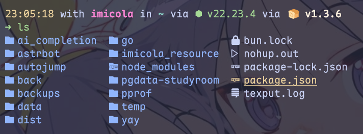

在 [命令行的艺术(上)](/posts/命令行的艺术(上)/) 这里，我们讲述了如何配置一个好看的命令行，而这节中的内容，我会讲述一些 Linux 命令和 Pwsh 命令中我常用的一些命令构造和常用的程序命令

## 导航

在 Windows 图形化界面下，在文件夹之间导航很容易~~其实效率比linux高多了~~

当你拥有 Windows 文件管理系统或者一个图形化的文件管理系统的时候，大大方方用，在 Windows 下可以通过在当前文件夹下 「右键」打开菜单栏然后找到 「在终端中打开」，随后终端就会自定位到这个目录下，省去了默认从 ~ 移动到想要到达的目录的麻烦

如果你很喜欢 *WSL跨系统文件*，即 `/mnt/d/.....` 这种东西，那你在上面的操作下的终端中输入 `wsl` 就可以将 wsl 定位到这种地方，如果你比较正常，用的是 wsl 原生文件目录，照样可以邪修，只需要在这个目录下输入 `explorer.exe .` 就可以用 Windows 的文件管理器打开 Linux 的文件目录 ~~(我说用neovim装文件导航插件然后开nvim内置shell用或者Vscode Remote也未尝不可)~~

---

当然，要是你 *实在是没有GUI文件目录* ，熟悉一下 Linux Shell 的导航逻辑也是未尝不可的

首先是列出当前目录下的所有文件，你可以使用 `ls` 命令，这里推荐使用 `eza` 来代替 `ls`，在 `.bashrc` 或者 `.zshrc` 中写上这么一句 `alias ls="eza --icons --group-directories-first"` 就可以享受到下面这样的 `ls`

`ll` 命令也会自动延续效果，原因是在 Zsh 中，输入 `type -a ll` 可以得到 `ll is an alias for ls -lh`，故自动递归到 `eza` 的效果了

然后是一些 `cd` 命令的小用法

- `cd` 直接输入会回到 `~`
- `cd ..` 是回到上一级目录，`cd ...` 则是上两极
- 在Zsh中上述命令可以被简化成 `..` 和 `...`
- `cd -` 可以回到上一个目录中

## 命令

- 使用 fzf 来改善查找命令历史，文件与文件夹的动作，在fzf下，按  `ctrl+R` 搜索命令历史，按 `ctrl + T` 搜索文件，`alt+C` 搜索文件夹，这些搜索都是模糊搜索
- 善用管道符拼接命令，` xxx | grep ` 很好用，在 windows 的神秘 pwsh 语法上可以使用 `Select-String` 来达到差不多效果
- 有一个很神秘的写法 `2>&1` ,其实是将 *stderr* 重定向 *stdout* 的流中,这个适合单开一个小知识点博客讲一讲，现在没时间(
- 配置 `.ssh/config` 是不错的选择
- 善用 Linux 下的 `\` 或 Windows pwsh 的 `反引号` (\`) ，可以将复杂的长命令多行拆分，适合排障
- Linux下，你或许可以尝试用 `lazygit` 来管理 git 仓库，用 `yazi` 来作为终端文件资源管理器，用 `btop` 来作为资源管理器，上述的三个工具都可以使用  [Catppuccin](https://catppuccin.com/) 主题
- 好像不知道写啥了（？
