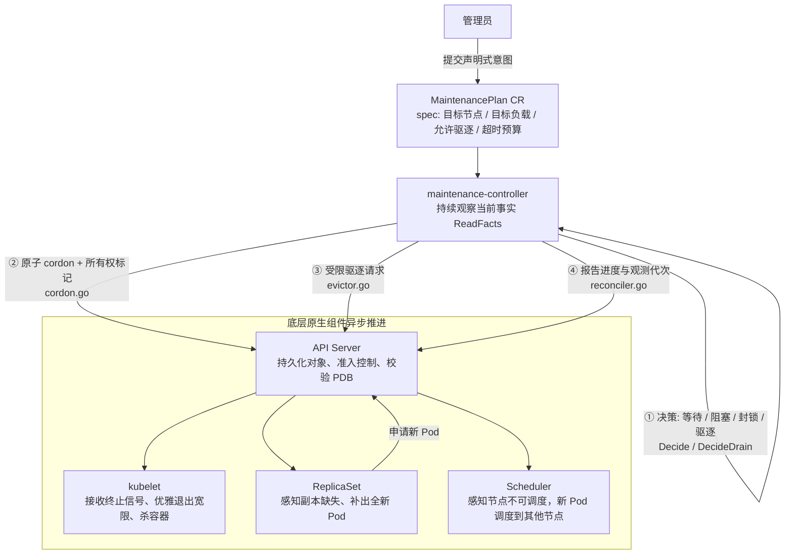
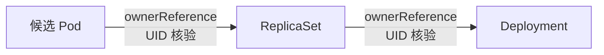

本文基于我自己的学习项目 [sentinel-go](https://github.com/imicola/sentinel-go) 的 `maintenance-controller` 模块，把开发过程中沉淀的项目笔记整理成上下两篇。这是上篇，讲清楚这个控制器**是什么、为什么、以及它如何与 Kubernetes 的原生组件协作**；下篇讲一个真实的 bug 剖析、三个时间概念、从 Go 结构体到 etcd 的持久化链路，以及容器化部署。

::github{repo="imicola/sentinel-go"}

## 架构全貌

### 业务场景

*maintenance-controller* 项目叫这个名字，直译过来看就是「维护控制器」，我们需要解决一个在 k8s 维护中切实存在的问题，即**在保障业务不中断（或严格遵守业务可用性契约）的前提下，将目标节点上的工作负载安全地排空**。

如果我们简单地使用 `kubectl delete pod`，就违反了工程上重要的优雅退出流程，同时可能会导致服务中断与雪崩等事件。所以我们的项目引入一种自定义资源 `MaintenancePlan`，用于将管理员一次性的维护意图翻译为一种受控的、分阶段的协调动作。

### k8s 式哲学：循环协调

在 k8s 中，当我们观察到「Pod 从节点 a 移动到节点 b」这个现象，并不是 k8s 用了一个剪切粘贴键一键将 Pod 移动到了另外一个节点，而是一次有条理的协调过程（要不然万一一个节点在西雅图一个在北京，这怎么粘贴过去）：

1. 首先是我们的控制器向 API Server 发起一次驱逐请求（*Eviction*）
2. 节点的 *kubelet* 收到删除通知，推进旧 *Pod* 优雅退出并销毁
3. *ReplicaSet Controller* 观察到实际的健康副本数少于期望的副本数，于是向 *API Server* 申请创建一个全新的 *Pod*
4. *kube-scheduler* 为这个新的 *Pod* 自动选择合适的节点，同时由于目标节点已经被 *cordon*，所以新的 Pod 会被调度到其他健康节点
5. 新节点上的 *kubelet* 启动新容器，在探针检测就绪后开始对外提供服务

所以表面上的「移动」实际上是一次重部署的过程。

### 组件的职责边界

在整个项目的组件中，逻辑链条按下面的方式推进：



### 源码分工映射

- `main.go`：模块入口，用于解析启动参数和确定运行模式，同时构建依赖注入对象
- `fact.go` 中的 `ReadFacts`：只读采集当前集群的真实状态
- `decide.go`：负责决策，通过「输入 Fact → 输出 decision」来判断当前应该是等待、阻塞、报错、封锁还是驱逐
- 执行层面由 `cordon.go` 与 `evictor.go` 构成，前者负责 cordon 节点，后者负责发起驱逐，这两个文件直接和 API Server 交互
- `reconciler.go`：模块的核心代码，负责串联「读事实 → 决策 → 前置持久化 → 执行 → 推进状态」的完整 *Reconcile* 循环
- `plan_type.go` / `k8s/maintenance-crd.yaml`：定义 CRD 结构体、JSON tag 与常量，以及 Scheme 注册入口

## CRD、CR、Scheme

**CRD（CustomResourceDefinition）**：重点在于 *Definition*，它告诉 k8s API Server 我们的资源中有一种叫 `MaintenancePlan` 的资源，其 API 分组、版本、字段结构都是什么。CRD 必须通过 `kubectl apply -f k8s/maintenance-crd.yaml` 安装到集群中，可以理解为一份表单模板。

**CR（CustomResource）**：CRD 中 D 的就是这个 CR，是某一份具体的申请实例。在集群中创建一份 CR 只相当于填写好一份表单，集群业务不会自动发生变化——必须有一个正在运行且具有充足权限的控制器进程去监听和协调它。

**Scheme（Go 运行时的类型注册表）**：k8s 的很多状态资源都是通过 JSON 格式保存或传递的，Scheme 规定了 Go 代码中如何将 JSON 字节流转化为具体结构体 `&MaintenancePlan{}`。

## k8s 中的标识符

| 标识字段 | 控制器中的作用 |
| --- | --- |
| `metadata.name` / `namespace` | 定位资源的请求 Key，作为 Reconcile 队列的索引 |
| `metadata.uid` | **唯一身份证**。整个生命周期全局唯一。本控制器用来绑定 Plan、Node、Deployment 以及待驱逐 Pod 的单次生命周期 |
| `metadata.generation` | **Spec 期望代次**。每当用户修改了 `spec`，API Server 会自动递增它。控制器把处理完的代次记录在 `status.observedGeneration` |
| `metadata.resourceVersion` | **并发控制版本（etcd 事务版本）**。Update 操作如果携带了旧版本号，API Server 会直接返回 409 Conflict |

> [!NOTE]
> **spec 与 status 的契约**
> - `spec` 表达的是**用户的期望目标与授权边界**
> - `status` 表达的是**控制器当前观察到的事实与推进阶段**
>
> 写 `status` 不会改变物理世界的运行状态：我们在 status 中把 phase 改成 `WorkloadEvacuated`，并不意味着真实的旧 Pod 已经退出、新 Pod 已经健康运行。status 只是一份事后报告，和真实集群状态解耦。

## 保守契约

在 `plan_type.go` 中，控制器在进入疏散流程的第一时刻，就会将 `plan.Generation` 和 `fact.TargetUID` 保存在 `status.evictionProgress` 中：

```go
type EvictionProgress struct {
    PlanGeneration int64         `json:"planGeneration"`
    DeploymentUID  string        `json:"deploymentUID"`
    StartedAt      metav1.Time   `json:"startedAt"`
    Deadline       metav1.Time   `json:"deadline"`
    ActivePod      *ActivePodRef `json:"activePod,omitempty"`
    NextActionAt   *metav1.Time  `json:"nextActionAt,omitempty"`
}
```

这样在后续协调中，如果协调器发现用户修改了 Plan 的 spec，或者说目标的 Deployment 被人删除重新创建，那么控制器就会立刻**中止自动推进**，将 Phase 置于 *Blocked* 并交由人工排查——我们不能将上一代意图或旧对象的处理进度，悄悄套用到新对象身上。

### ReadFacts：只读采集，失败即重试

核心协调器 `reconciler.go` 中，第一步就是调用 `fact.go` 的 `ReadFacts`：

```go
facts, err := ReadFacts(ctx, r.Client, plan.DeepCopy())
if err != nil {
    return ctrl.Result{}, err
}
```

失败就立刻重试。例如当 API Server 因为网络抖动或者临时超时导致 List Pod 失败，此时我们的控制器应该原样上抛错误，而不能当作默认值进行处理。

在观察获取目标节点 Fact 的时候，必须跨所有命名空间扫描 Pod。这是因为我们不能确定节点的其他命名空间中是否存在其他未知业务的 Pod，如果贸然维护可能会引起未授权的业务中断。

当我们关注 Deployment 的时候，这是在命名空间中按 Label Selector 圈选出候选 Pod，再沿着所有权链逐级向上核验：



只有当每一级 UID 核验都通过的时候，才能确定亲缘关系。

### cordon 的防并发篡改设计

在进行 cordon 的时候，也有一些设计来防止并发篡改：

- **提交前先读核验**：在准备写 Node 之前，再次从 API Server 读取 Node 的最新状态，核验其 UID 是否依然匹配、是否已被其它未知流程修改
- **原子写入所有权注解**：在 `cordon.go` 中，控制器在将 `node.Spec.Unschedulable = true` 的同时，将当前 Plan 的 UID 写入注解 `MarkerAnnotation = "maintenance.studymate.io/cordon-plan-uid"`。设为不可调度与记录「是谁封锁了这个节点」被合并在一次针对 Node 的 Update 调用中，从而降低了「节点被封锁但是记录没来得及标记」的中间窗口

如果节点早已被其他的运维系统封锁，则控制器会报告节点被占用并且等待人工确认，而不是自行继续驱逐排空。

## Eviction 校验

在我们的程序中，都是通过走 Eviction API，而不是直接 DELETE Pod。普通的 DELETE 请求通过直接操作 `api/v1/namespaces/{ns}/pods/{name}` 对一个 Pod 进行无条件删除，而不会经过 PDB 校验；Eviction 请求通过操作 Pod 的**子资源** `api/v1/namespaces/{ns}/pods/{name}/eviction` 对 Pod 驱逐，其专门为受控维护设计。在 API Server 收到 Eviction POST 请求的时候，内部的准入控制器会实时查询保护该 Pod 的 *PodDisruptionBudget*（PDB）：

- 如果当前健康副本数在驱逐后依然满足 PDB 的最低要求（如 `minAvailable`），API Server 批准该请求，并将 Pod 置为删除中；
- 如果驱逐该 Pod 会破坏 PDB 的可用性下限，API Server 会**直接拒绝该请求，并返回 HTTP 429 Too Many Requests**。

### 预检通过不一定驱逐成功

代码中有两个阶段：预检阶段与动作阶段。预检阶段只观察集群中 PDB 状态，在观察到 `disruptionsAllowed > 0` 时才尝试进入动作阶段，向集群 `pods/<name>/eviction` 发起 POST——但依然可能返回 429。

> [!TIP]
> 为什么明明预检时看到 `disruptionsAllowed > 0`，真正发请求时依然可能收到 429？
>
> 因为**读取和提交之间不是原子事务**。在微秒级的网络时间差内，可能其他节点的同业务 Pod 刚刚发生故障退出，导致 PDB 预算被瞬间抽干；或者服务端的 PDB 控制器更新 status 存在毫秒级的延迟。因此，预检通过只是拿到了一张「准考证」，真正的裁决权永远在服务端手上。

### 错误与错误处理

`reconciler.go` 的 `evictOne` 中，每一次驱逐调用的返回都被严格分类：

```go
callCtx, cancel := context.WithTimeout(ctx, evictCallTimeout)
defer cancel()

err := r.Evictor.EvictPod(callCtx, d.Evict.Namespace, d.Evict.Name, d.Evict.UID)
```

1. `err == nil`：API Server 明确受理，Phase 保持 `Draining`，Reason 置为 `eviction-request-accepted`
2. `errors.IsNotFound(err)`（HTTP 404）：目标 Pod 已经不存在，此时清空 ActivePod 并重新评估流程
3. `errors.IsTooManyRequests(err)`（HTTP 429）：
   - 如果错误消息中包含 PDB 拒绝文本（`isPdbRefusal`），Reason 设为 `pdb-budget-exhausted`
   - 如果原因未知，Reason 置为 `eviction-throttled`
   - 从错误中提取 `errors.SuggestsClientDelay(err)`（服务器建议的重试间隔），并加上最大上限保护，计算出冷却延迟
4. `errors.IsForbidden(err)`（HTTP 403）：控制器 ServiceAccount 缺少在目标命名空间创建 `pods/eviction` 的 RBAC 权限。此时将 Phase 置为 `PhaseBlocked`、Reason 置为 `eviction-forbidden`，不进行自动重试，上报人工
5. `isKnownEvictionMisconfiguration(err)`（HTTP 500）：集群中存在多个选择器重叠且产生冲突的 PDB，导致 API Server 计算死锁抛出 500。转为 Blocked 并提示配置错误，交人工修复
6. 其他错误：按 Unknown 处理，保留已经保存的 ActivePod，上抛给外部，下一轮重读后再做定夺

## 小结

上篇到这里：我们从「为什么不能直接 delete pod」出发，定义了 `MaintenancePlan` 这个 CRD，梳理了 Reconcile 循环的读事实 → 决策 → 执行结构，并重点讨论了 Eviction 子资源与 PDB 的裁决机制。

在下篇中，我们将剖析一个由 Watch 事件风暴引发的真实 bug（429 洪泛），以及由此引出的三个时间概念、Go 结构体到 etcd 的持久化链路和容器化部署——敬请期待。
