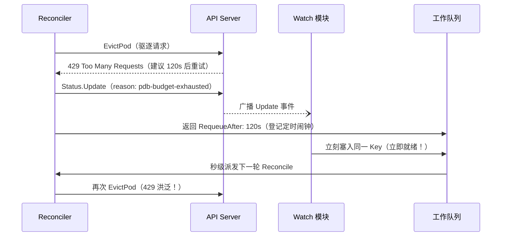
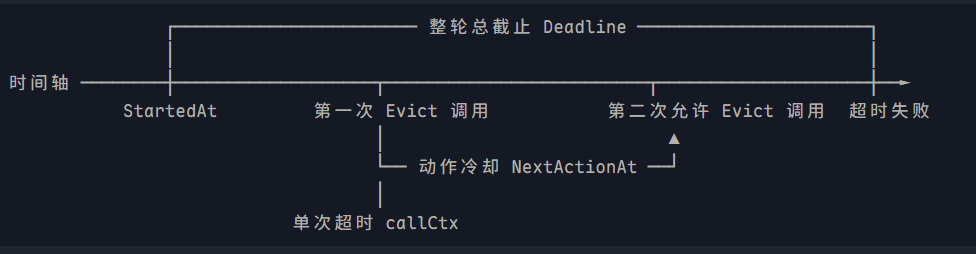
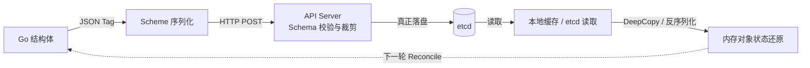

这是 [用Go写一个K8s维护控制器(上)](https://blog.imicola.com/posts/用Go写一个K8s维护控制器(上)/) 的下篇。上篇讲了架构全貌、CRD 与对象身份、保守契约以及 Eviction 与 PDB 裁决；本篇进入更有意思的部分：一个真实 bug 的完整剖析、三个时间概念、从 Go 结构体到 etcd 的持久化链路，以及容器化部署。

::github{repo="imicola/sentinel-go"}

## 一个 bug 剖析：429 洪泛与 Watch 事件风暴

### 现象

在初期版本中，当控制器向 API Server 发起驱逐被 PDB 拒绝（429）后，API Server 明确通知「请 120 秒后再重试」，代码中也顺理成章地写了：

```go
return ctrl.Result{RequeueAfter: 120 * time.Second}, nil
```

然而，在查看控制器的运行日志的时候，发现了密集的 429 错误返回——本来应该是间隔 120 秒的错误，现在几毫秒就刷一条。

### 溯源

通过深入 *controller-runtime* 的底层，我们发现控制器在启动时注册了对 `MaintenancePlan` 的主资源监听：

```go
ctrl.NewControllerManagedBy(mgr).For(&MaintenancePlan{}).Complete(r)
```

这意味着：**集群中任何针对 `MaintenancePlan` 对象的修改（包括对它的 Status 的修改），都会产生一个 Update Event，并通过 Watch 机制推回给本控制器**。

在我们的一轮调用中，时序如下：



所以说，`RequeueAfter` 只是在内存中挂了一个「稍后入队」的闹钟。但只要你在本轮写了 status，产生的实时事件就会瞬间把同一个任务踢醒。

### 解决：NextActionAt 冷却门

解决这个问题的方法，是在 CRD 中添加一个 `NextActionAt` 字段，持久化一个**绝对时间戳**：

```text
NextActionAt = CurrentTime + Delay
```

整个机制的运转策略如下：

1. **调用前先落保底门**：在真正发出 `EvictPod` 调用前，先在 status 中保存一个基础冷却时间（如 `now + 10s`），成功落盘后再发起调用。这样即使进程在发出网络包后瞬间崩溃，重启后的新进程也能看到这道门，不会立刻发起重试；
2. **收到 429 后更新绝对时刻**：当收到 429 且服务端给出 120 秒建议时，计算出绝对时刻（例如 `10:02:00`），更新并持久化到 etcd；
3. **提前唤醒时被冷却门挡住**：此时即使 Watch 事件在 1 秒后又把控制器踢醒，控制器读出 `nextActionAt = 10:02:00`，拿当前时间一比对，发现「距离冷却结束还有 119 秒」。此时控制器**直接放弃调用，平静地返回剩余等待时间 `ctrl.Result{RequeueAfter: 119s}`**，绝不发出任何网络请求；
4. **跨进程重启完美自愈**：如果控制器中途挂掉，50 秒后新进程启动，读到 `nextActionAt = 10:02:00`，依然能精确算出还需等待 70 秒，绝对不会把 120 秒倒计时清零重新来过，更不会产生任何多余请求。

这套机制在 `reconciler.go` 中有严格的先后顺序：

```go
// 先走全面的事实判断！
d := DecideDrain(plan, &f, now)

// 只有当业务决策明确要求「发起一次新驱逐动作 (ActionEvict)」时，冷却门才生效！
if d.Action == ActionEvict {
    next := plan.Status.EvictionProgress.NextActionAt
    if next != nil && now.Before(next.Time) {
        // 门只拦住「鲁莽的新动作」，绝不拦住「对已发生事实的汇报」
        return ctrl.Result{
            RequeueAfter: next.Time.Sub(now),
        }, nil
    }
    return r.evictOne(ctx, l, plan, d)
}
```

冷却门管辖的是「动作的准入」，绝不能干涉「事实的认知」。

## 三个时间

在整个疏散流程中，代码里出现了三个和时间相关的机制，它们各自回答不同的问题。流程如下：



三个时间概念如下：

- **单次调用超时**：`evictCallTimeout = 10s` 与 `context.WithTimeout`
  - 表示这一次向 API Server 发送的 HTTP 请求最多等待多久必须返回
  - 超时后会释放本地底层 HTTP 连接与 Goroutine 资源
  - 超时返回只代表客户端放弃等待，不能反推服务端没有执行
- **整轮总截止**：`spec.drainTimeoutSeconds` / `status.evictionProgress.Deadline`
  - 表示一整轮维护任务，从开始算起最多允许任务推进到什么时刻
  - 一旦 `now.After(deadline)`，决策层立刻将状态推入 `Blocked/deadline-exceeded`，停止一切驱逐动作
- **动作冷却时刻**：`status.evictionProgress.NextActionAt`
  - 表示下一次最早允许向 API Server 尝试发出新驱逐调用的绝对时刻是几点几分
  - 阻止过密调用与 429 洪泛。属于动态推进的冷却门，被拒绝则向后推移，未达到该时刻只等待、不发包

## 从 Go 结构体到 etcd 持久化

在真实的 k8s 体系中，一个字段要真正安全地落入 etcd 并且在重启后能被准确读出，必须经历下述环节：



这其中有几点需要注意：

- **Go 字段与类型定义**：必须使用指针类型 `*metav1.Time`。如果使用普通类型，零值会被序列化为一个无意义的时间戳；而指针类型的 `nil` 则可以表达「当前没有冷却约束 / 历史旧版本 CR 没有该字段」，从而实现向前兼容
- **JSON Tag 契约**：需要明确指定 `json:"nextActionAt,omitempty"`，以确保序列化时的字段大小写与 CRD 定义的完全一致
- **CRD OpenAPI v3 Schema 声明**：在 `k8s/maintenance-crd.yaml` 中必须明确加入 `nextActionAt` 的字段声明，如果遗漏则会被 API Server **静默丢弃**
- **深拷贝与浅拷贝**：在协调器比对状态变化的时候，不能简单使用 `before := plan.Status`。因为 `Status` 内部包含指针，浅拷贝会复制指针地址——后续修改了 `NextActionAt` 后，由于 `before` 中的指针指向同一个地址，它也会「跟着变成」新值
- **无变化不写（`statusEqual`）**：在 `writeDrainStatus` 中，每次准备写 status 前都会比对 `statusEqual(before, plan.Status)`。只有当状态、原因或冷却时刻真正发生变化时才调用 API。这不仅是为了降低 API Server 的写入负载，更是为了防止无意义的 Update 再次激起前面分析过的 Watch 事件风暴

## 容器化

说到底这还是一个集群项目，所以我们需要将整个模块构建成一个 container 才能部署进集群。

标准构建指令是：

```pwsh
docker build -f module/maintenance-controller/dockerfile.controller -t maintenance-controller:w45 module/maintenance-controller
```

其中 `-f` 指定的是构建规则文件的具体位置，最后的参数 `module/maintenance-controller` 是真正的**构建上下文**。在 Dockerfile 中写 `COPY go.mod go.sum ./` 时，Docker 引擎是以这个上下文根目录为基准去寻找文件的，所以打构建命令的时候不能把上下文弄混了。

### 两阶段构建

`dockerfile.controller` 采用两阶段构建：

- **构建阶段（builder）**：基于完整的 `golang:1.24-alpine` 镜像，构建出完全静态的纯 Linux 二进制可执行文件
- **运行阶段（runtime）**：丢弃所有的 Go 编译工具链，直接基于极简的 `distroless/static:nonroot` 镜像，以非 root 用户启动

### 显式双入口设计

在 `main.go` 中，我们提供了两种运行模式，通过启动参数 `--mode` 显式区分：

- `--mode local`：开发测试阶段的本地运行，控制器跑在本地主机，直接调试代码
- `--mode in-cluster`：生产部署阶段，控制器打包为容器跑在 Pod 内部

## 结语

到这里，maintenance-controller 的项目笔记就整理完了。回头看，这个项目最有价值的部分不是「实现了一个排空节点的工具」，而是在实现过程中被迫去理解的那些 Kubernetes 的底层机制：Watch 与工作队列的交互语义、status 写回的副作用、PDB 裁决的非原子性、以及一个字段从 Go 结构体到 etcd 的完整生命周期。

如果你也在学习 Kubernetes controller 开发，欢迎看看 [sentinel-go](https://github.com/imicola/sentinel-go/tree/master/module/maintenance-controller)，也欢迎交流指正。
